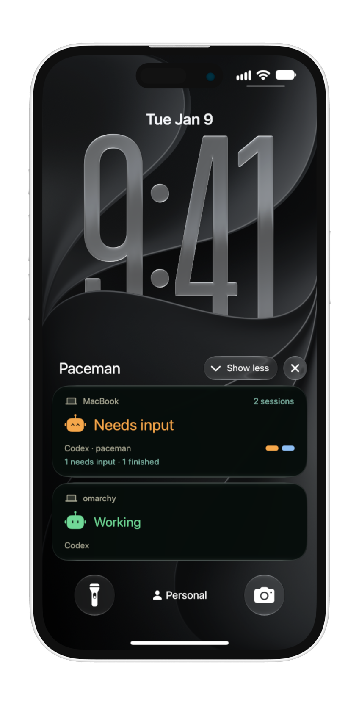
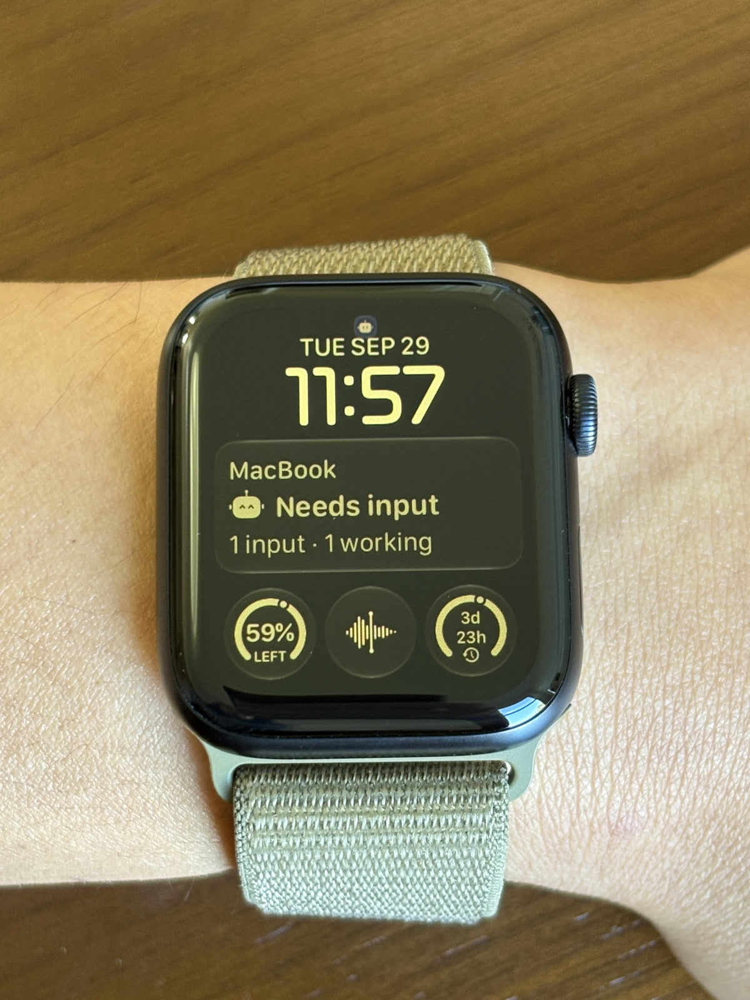

# Paceman

**Take your agents for a walk.**

Paceman brings Codex and Claude Code activity from your Mac or Omarchy computer
to your iPhone Lock Screen and Apple Watch, so you can step away while your
agents build.

You can also respond to supported questions and approval requests on iPhone and
Apple Watch. Unsupported requests continue in the agent’s app; see
[coverage and limits](docs/native-request-coverage.md).

  
  

Your phone and Apple Watch are just the start. Paceman is an open personal gear
system for agentic engineering on the go, which you can extend to hardware you
choose, hack, or build.

Paceman is in **alpha**. macOS and Omarchy installers are available via GitHub
releases, and Paceman iOS is available through TestFlight.

## Get started

1. **[Get Paceman for iPhone on TestFlight](https://testflight.apple.com/join/wpMWQb7d)**.
2. **[Download the desktop client](https://github.com/iamjamesim/Paceman/releases)** and follow the [Mac setup](macos/README.md) or [Omarchy setup](omarchy/README.md) guide.

### Minimum requirements

- **iPhone:** iOS 18+.
- **Computer:** Apple Silicon Mac with macOS 15+, or Omarchy 4.0+ with Python 3.11+ and user systemd.
- **Agent:** Codex or Claude Code 2.1.196+ installed and running on a computer
  with Paceman set up and paired to your iPhone.
- **Claude Code responses:** an eligible claude.ai account with Remote Control
  enabled and active for the session. API-key-only and alternative-provider setups
  do not qualify; see [Anthropic’s requirements](https://code.claude.com/docs/en/remote-control#requirements).
- **Connection:** [Tailscale](https://tailscale.com/download) on your computer and iPhone.
- **Apple Watch (optional):** watchOS 26+. Session browsing, request review and
  answers require a live connection to the paired iPhone. Codex usage can update
  directly for complications; see [Watch connections](docs/architecture.md#watches).

Reviewed hooks provide activity monitoring separately; they do not enable
responses.

### How it connects

Each computer runs a local service. The iPhone reads activity and usage snapshots
and exchanges supported requests and answers over authenticated HTTPS through
[Tailscale](https://tailscale.com), so the service remains reachable away from
the local network without exposing its API to the public internet.

The service listens on loopback. Paceman configures Tailscale Serve and issues a
separate credential for each paired phone. Notifications, Live Activities and
Apple Watch activity updates use Paceman's relay and Apple Push Notification
service.

### Availability gaps

- Cloud-only sessions are unsupported.
- Sessions started remotely but running in Codex desktop on a Mac can show
  activity while approvals are inaccessible. Try opening the thread in Codex on
  that Mac, then check Paceman again. An assistant with access to your Mac may be
  able to do this for you.

### Manual installation

- **Mac:** [Build and install from source](macos/README.md#build-and-install-from-source).
- **Omarchy:** [Install from a Git checkout](omarchy/README.md#install-from-a-git-checkout).
- **iPhone:** [Build with Xcode](docs/development.md#iphone-and-live-activities-mac).

## Experimental accessories

Paceman can extend to gear you choose or build:

- [Pebble Time 2](firmware/pebble-time-2/README.md) running modified PebbleOS
  firmware to work as a Paceman accessory.
- [ESP32-S3 watch](firmware/esp32-watch/README.md) with custom firmware focused
  on agent activity.

To connect an accessory, follow the [setup guide](firmware/README.md).
To adapt or build your own, start with the
[accessory protocol](docs/protocol.md#iphone-and-esp32-watch-ble) and the firmware
above.

## Privacy

- Activity snapshots and notification payloads contain status, Codex usage and
  limited metadata, including optional session titles. They exclude prompts,
  agent replies and tool arguments. Optional project labels can appear on your
  Lock Screen.
- Supported request content and your answers travel privately between your
  computer and paired iPhone, and through the iPhone to Apple Watch. They are
  excluded from activity snapshots and Paceman’s relay/APNs payloads.
- Claude Code requests and responses also use its existing Remote Control
  connection through Anthropic.

See [data and lifecycle](docs/data-lifecycle.md#questions-and-approvals) for data
flow, and the [privacy policy](https://paceman.ai/privacy) for service providers,
diagnostics, retention and privacy requests.

## Documentation

- [Architecture](docs/architecture.md): how the system fits together.
- [Data and lifecycle](docs/data-lifecycle.md): privacy, storage and recovery.
- [Push delivery](docs/push-delivery.md): notifications and background updates.
- [Protocol](docs/protocol.md): source and accessory interfaces.

## Repository

| Path | Purpose |
| --- | --- |
| `service/` | Source service and notification relay |
| `macos/` | Mac client and agent hooks |
| `omarchy/` | Omarchy client and agent hooks |
| `ios/` | iPhone and Apple Watch apps |
| `firmware/pebble-time-2/` | PebbleOS integration |
| `firmware/esp32-watch/` | ESP32-S3 firmware and simulator |
| `tests/`, `scripts/` | Checks and development tools |

## Contributing

- [GitHub Issues](https://github.com/iamjamesim/Paceman/issues) for bugs and suggestions.
- [Private security reports](SECURITY.md) for vulnerabilities.
- [Development guide](docs/development.md) for builds and tests.

## License

- [Apache 2.0](LICENSE) for original Paceman code, documentation and artwork.
- [Third-party notices](THIRD_PARTY_NOTICES.md) for imported code and assets.
